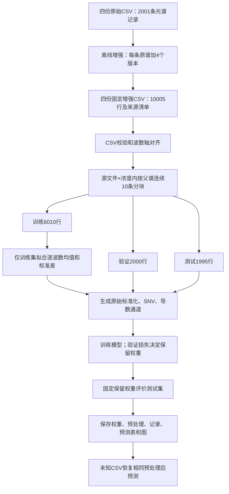

工程审阅记录（2026-10-17）

后续状态：本文保留修正前的审阅快照。最低损失权重与早停解耦的问题现已在training_control.py及训练/汇总/自检链路修正，详见README.md；网络结构消融的工程扩展建议见EXPERIMENT_DESIGN.md。本文引用的历史第7轮权重和第26轮损失仍是旧实验事实，不能视为重新训练后的结果。

本记录依据当前工作区全部11个Python源文件、README.md、EXPERIMENTS.md、requirements.txt、.gitignore、四份原始CSV、四份扩充CSV及其清单、现有模型3权重、训练记录、逐条预测与图表。完成了真实数据核对、完整软件自检和现有权重的CPU重新推理；没有重新开展真实数据训练。

**判断：作为国创创新训练项目的模型软件部分，已有合格的研究原型基础；作为整个国创项目的最终研究成果，当前目录中的证据尚不足以直接认定结题完成。** 最重要的补充是可靠的实验对照和独立验证，而不是继续堆叠网络模块。实际验收需对应学校细则及立项任务书。

教育部《国家级大学生创新创业训练计划管理办法》强调学生自主实践、研究过程、研究报告与成果交流，并规定结题验收由所在学校组织、各高校制定实施细则。因此以下为技术审查意见，不是学校验收结论。[教育部文件的高校转载全文](https://zhuanti.sdut.edu.cn/2019/0826/c3516a334550/page.psp)

**研究目标可以准确表述为：使用拉曼光谱，识别MG1、R6G单组分及二者混合样品，并研究不同光谱表示对轻量一维卷积分类模型的影响。**

当前任务是三个互斥类别：0=仅MG1，1=仅R6G，2=两者都有。输入为524个波数位置的强度，输出为三类Softmax分数和最终类别。模型3使用标准化强度、SNV和一阶导数三个通道。

工程不预测浓度、混合比例或任意化学成分，不包含“二者都无”的类别。CSV中的浓度文字只用于拆分和评价，不作为网络输入。两个混合文件均赋予类别2；文件名和现有浓度列不足以核实全部配液比例、单位和实验批次。

对应的研究问题应是：SNV是否改善对强度变化的适应能力？一阶导数是否补充峰形信息？二阶导数是否引入噪声？多通道网络相对简单方法是否有稳定收益？目前实现了这些问题的一部分实验工具，但尚未在当前目录保存足够的对照结果。

**当前目录框架如下；pt和output只存在模型3的真实实验产物。**

```text
R6gMg_classify/
├── config.py                         公共路径、任务版本、类别、通道、设备、种子
├── augment_dataset.py                离线光谱增强，当前尚未纳入Git
├── data.py                           CSV读取、溯源、拆分、预处理、Dataset
├── train.py                          单模型训练入口，默认模型3
├── run_all.py                        四通道版本训练、拆分一致性检查与汇总
├── metrics.py                        批量推理、分类指标、分组统计与绘图
├── predict.py                        加载权重、恢复预处理、预测未知CSV
├── check.py                          临时合成数据上的完整流程自检
├── models/
│   ├── __init__.py                    导出ReagentClassMSNet
│   ├── blocks.py                      SEBlock1d、MultiScaleResidualBlock
│   └── net.py                         ReagentClassMSNet网络主体
├── requirements.txt                  直接依赖固定版本
├── README.md                         操作说明与结果解释
├── EXPERIMENTS.md                    通道递增实验设计与结论表述
├── .gitignore                        忽略私有数据、权重、结果及缓存
├── data/
│   ├── MG1.csv                        500条
│   ├── R6g1.csv                       499条
│   ├── R6g1_MG1.csv                   502条
│   └── R6g1_MG2.csv                   500条
├── data_augmented/
│   ├── 上述四份同名CSV                 合计10005行
│   ├── augmentation_manifest.csv      来源和每轮增强操作轨迹
│   └── augmentation_config.json       增强参数、数量、原始文件SHA-256
├── pt/model3/best.pt                  实际存在的模型3权重
├── output/model3/
│   ├── training_config.json           本次训练参数与输入数据指纹
│   ├── test_metrics.json              总体评价和样本数量
│   ├── 结果摘要.txt
│   ├── figures/
│   │   ├── training_history.png
│   │   └── test_confusion_matrix.png
│   └── tables/
│       ├── dataset_manifest.csv       及中文“数据拆分清单.csv”
│       ├── training_history.csv       及中文“训练记录.csv”
│       ├── test_predictions.csv       及中文“测试集逐条预测.csv”
│       ├── test_metrics_by_concentration.csv / 按浓度测试结果.csv
│       └── test_metrics_by_role.csv / 按类别测试结果.csv
├── __pycache__/                      Python运行缓存
├── .git/                             版本库元数据
└── PROJECT_REVIEW_2026-10-17.md        本次审阅记录
```

README中展示的pt/model1、model2、model4和output/compare是脚本可生成的产物；当前真实实验目录没有这些文件。软件自检确实会在临时目录训练四个模型各1轮，但使用的是合成数据，结束后清理，不能用来替代真实消融实验。

**各代码文件的主要职责与代码块关系如下。**

| 文件 | 主要函数或类 | 输入、输出与职责 |
|---|---|---|
| config.py | ChineseParser、setup_console、set_seed、choose_device | 统一中文命令行、路径、三分类顺序、四种通道、格式版本6和设备选择 |
| augment_dataset.py | shift_with_edge_values、selected、augment_one、expand_file、main | 读取原始CSV，保留原谱并生成增强谱，写CSV、逐行轨迹和配置JSON |
| data.py | resolve_data_specs、parse_data_spec、data_fingerprints | 定位训练文件、检查角色、生成SHA-256指纹 |
| data.py | concentration_group、read_spectral_csv、load_training_data、validate_targets | 解析浓度、修复少量缺失、检查波数轴、必要时插值、绑定文件角色与标签 |
| data.py | grouped_stratified_split | 在源文件×浓度分层内按父光谱连续块拆分，同源增强版本不跨集合 |
| data.py | SpectralPreprocessor、SpectraDataset | 训练集拟合标准化参数；生成多通道张量；保存和恢复预处理；提供DataLoader输入 |
| models/blocks.py | SEBlock1d、MultiScaleResidualBlock | 三个尺度卷积分支、残差融合、SE通道注意力、Dropout1d |
| models/net.py | ReagentClassMSNet.forward | 多通道光谱→卷积特征→三种池化→三个logit，不在网络内部计算Softmax |
| models/__init__.py | 模型导出 | 支持from models import ReagentClassMSNet |
| train.py | train_epoch、command_train | 单轮梯度更新，以及读取、拆分、预处理、训练、选择权重、测试、保存的完整流程 |
| train.py | add_training_arguments、validate_arguments、build_parser、main | 统一训练参数和入口校验，供run_all共用 |
| metrics.py | predict_loader、compute_metrics | eval模式推理、Softmax、未加权评价交叉熵、三分类和成分存在指标 |
| metrics.py | make_prediction_frame、metrics_by_group、plot_history、plot_confusion、json_default | 逐条预测、浓度/角色分组统计、图表和JSON序列化 |
| predict.py | load_checkpoint、command_predict、main | 校验任务版本，恢复波数轴/预处理/模型，预测未知CSV并导出中文表 |
| run_all.py | build_train_command、can_skip、verify_identical_splits | 调用四次独立训练；检查完整产物、参数、数据指纹；核对四模型拆分一致 |
| run_all.py | collect_results、to_chinese_table、plot_summary、main | 生成总体、浓度、角色三类对比表及柱状图；不自动选择最终模型 |
| check.py | make_data、run、require、main | 临时独立工程中的语法、数据、增强、拆分、四模型训练、预测和缓存复用检查 |

模块依赖的主干为：config→data/models/metrics→train/predict→run_all；check调用整条链。没有循环依赖问题。数据读取、模型结构、训练、推理和评价的职责划分合理。

**训练与预测的实际流程如下。**



图中的验证和测试数据只使用训练集已拟合的参数；它们不重新拟合标准化。增强在各原谱内部独立执行，没有利用全体测试数据估计增强参数；虽然工程先生成增强CSV再划分，但因同源绑定，不能仅凭“增强发生在拆分前”认定已有泄漏。

1. 原始CSV第一行为标题和数值波数轴，第1、2列分别为编号、浓度文字，第3列起为光谱强度。四文件的角色由配置或--data指定，不能依靠未知CSV中的文字自动校验化学标签。
2. 读取函数检查轴严格单调，可反转下降轴；少量内部缺失点插值修复，边缘缺失或过多缺失报错。其他波数轴在覆盖参考范围时可以插值到第一文件的轴。真实数据中MG1有2个缺失点被修复，四个文件不需要轴插值。
3. 离线增强保留原谱，另造4份版本，每份都从原谱重新开始，重复5轮“平移→增益→高斯噪声”。固定种子66，输出编号如00023_0～00023_4，并保存来源和轨迹。
4. 训练按编号恢复父光谱，在每个文件×浓度层内按连续10条父谱组成块，整块分到训练、验证或测试；样本少于3个块时可退化为逐父谱拆分，并写提示。
5. 仅训练集拟合逐波数均值和标准差。验证、测试与预测复用这些参数。
6. 模型用类别加权交叉熵训练，AdamW更新，梯度裁剪，按轮余弦退火；验证与测试用未加权交叉熵评价。
7. 依据验证损失和min_delta保留内存中的权重；连续patience轮无有效改善早停。训练结束才写best.pt，随后生成报告。
8. run_all以独立子进程训练四种通道，核对相同拆分后汇总。相同参数和种子不等于所有模型初始权重相同；输入维度不同会影响随机初始化序列，需重复实验估计波动。
9. predict恢复训练时波数轴、标准化参数、通道组合、网络权重，输出三类分数和成分存在分数。

**数据数量核实如下。**

| 来源 | 类别 | 原始记录 | 增强后行数 |
|---|---|---:|---:|
| MG1.csv | 仅MG1 | 500 | 2500 |
| R6g1.csv | 仅R6G | 499 | 2495 |
| R6g1_MG1.csv | 两者都有 | 502 | 2510 |
| R6g1_MG2.csv | 两者都有 | 500 | 2500 |
| 合计 | 三分类 | 2001 | 10005 |

波数范围约600.849～1799.617，524个点，间距约1.825～2.843，并非严格等间距。浓度标签覆盖10^-2～10^-6；CSV没有给出足以核验的统一物理单位和完整实验条件，正式报告应补充。

| 集合 | 父光谱记录数 | 原谱及增强版本总行数 | 实际行数比例 |
|---|---:|---:|---:|
| 训练 | 1202 | 6010 | 60.07% |
| 验证 | 400 | 2000 | 19.99% |
| 测试 | 399 | 1995 | 19.94% |

配置目标是65%/15%/20%，实际接近60%/20%/20%。原因是各分层内按块数取整，如10个块的0.15会取成2个验证块。报告应写实际数量，不能只写目标比例。

当前验证和测试也包含增强版本，这意味着1995个测试行对应399条父光谱记录，不能按1995个独立实验样本计算统计置信区间。原始记录本身是否来自独立配液样品，仍需批次和测量记录证明。

**预处理和模型结构有清晰的实现。**

对波数点j，原始标准化通道为(x_j-训练均值_j)/训练标准差_j，截断到[-10,10]。SNV通道对每条谱分别减去自身均值并除以自身标准差。一阶导数是SNV(gradient(SNV(raw), axis))；二阶导数是SNV(gradient(一阶导数通道, axis))。这里使用数值梯度，没有Savitzky–Golay平滑，也没有显式基线扣除或宇宙射线尖峰处理。

不同通道是同一测量信息的不同表示，不是额外传感器数据。它们可能帮助学习，但不能把通道数量直接当成新信息量或已证明的性能提升。

| 模型编号 | 通道 | 参数量 |
|---|---|---:|
| 1 | 标准化原始强度 | 72088 |
| 2 | 原始标准化+SNV | 72256 |
| 3 | 原始标准化+SNV+一阶导数 | 72424 |
| 4 | 原始标准化+SNV+一阶导数+二阶导数 | 72592 |

```text
模型3输入 [B,3,524]
  → Conv1d(3→24,k=7)+BatchNorm+GELU
  → 多尺度残差块(24→32)
  → MaxPool：[B,32,262]
  → 多尺度残差块(32→48)
  → MaxPool：[B,48,131]
  → 多尺度残差块(48→64)：[B,64,131]
  → 全局平均池化、全局最大池化、注意力加权池化
  → 拼接 [B,192]
  → Linear(192→64)+GELU+Dropout
  → Linear(64→3)：logit
  → 推理端Softmax：P(仅MG1),P(仅R6G),P(两者都有)
```

每个多尺度块含k=3、7、15三个并行卷积分支，拼接后1×1卷积融合，再加残差、SE通道权重和Dropout1d。平均池化提供总体响应，最大池化提供最强响应，注意力池化学习各波数位置的重要性。SE和注意力池化作用不同：前者重加权特征通道，后者重加权编码后的空间位置。

成分边缘分数为P(MG1存在)=P(仅MG1)+P(两者都有)，P(R6G存在)=P(仅R6G)+P(两者都有)。预测成分状态由三分类argmax映射得到，不是分别对两个边缘概率做0.5阈值判断。分类分数没有经过概率校准，不能解释为浓度或真实检测可靠度。

**当前真实训练结果能够复现。**

运行环境为Conda pytorch中的Python 3.12.12、PyTorch 2.6.0+cu124、NumPy 2.3.4、pandas 2.3.3、scikit-learn 1.7.2、Matplotlib 3.10.6；CUDA可用。直接运行系统python会使用另一份Python 3.13，复现时应明确环境。

训练配置为最大120轮、batch=32、学习率3e-4、weight_decay=1e-4、dropout=0.15、patience=20、min_delta=1e-4、梯度上限5、seed=66。实际训练27轮，保留第7轮权重。

| 项目 | 核实结果 |
|---|---|
| 扩充评价行数 | 1995 |
| 测试父光谱记录数 | 399 |
| 三分类准确率 | 100% |
| 三类别Macro-F1 | 1.0000 |
| MG1、R6G召回率 | 均为1.0000 |
| 测试交叉熵 | 文件记录约2.669×10^-5 |
| 10^-2～10^-6分组准确率 | 当前各组均为100% |
| 只保留测试中augmentation_index=0 | 399条记录准确率100%，Macro-F1=1 |
| CPU重新加载权重推理 | 相同分类结果；与原表概率最大差约2.27×10^-6 |

```text
增强行级混淆矩阵                 仅原始测试行的混淆矩阵
             预测                           预测
真实       MG1 R6G 混合           真实      MG1 R6G 混合
仅MG1      500   0    0           仅MG1     100   0    0
仅R6G        0 495    0           仅R6G       0  99    0
混合         0   0 1000           混合        0   0  200
```

软件自检5个阶段全部通过。原始文件与增强配置中SHA-256一致，增强文件与训练配置中SHA-256一致；重新计算的拆分与已有清单完全一致；同一父谱最多出现在一个集合；权重中的标准化均值和尺度与当前训练集重算结果完全一致；增强CSV的原始版本与修复后的原始CSV一致。

这些结果支持“在当前数据来源及当前内部拆分下，该模型区分三类非常容易”。不能据此直接认定新日期、新批次、新仪器、未知比例或真实复杂基质中的性能也是100%。本次没有发现父谱增强版本跨集合，也没有发现完全重复谱跨集合，因此没有证据把100%结果直接归因于这两类泄漏。

**需要修正和补充的事项，按研究影响排列如下。**

1. **当前缺少支持“模型3最佳”的真实对照文件。** EXPERIMENTS.md第45行已经把这点写成实验结论，但现有真实产物只有model3。当前只能确认它是代码默认模型；不能从这个目录复核它优于1、2、4。应补齐同一拆分上的四模型真实结果。若四模型全为100%，应诚实报告准确率未分出优劣，并在验证损失、独立验证、抗扰动表现、开销上比较。模型复杂度从模型3到4只增加168参数，仅凭这点不足以证明明显效率优势。
2. **增强参数说明与实际实验不一致。** README/EXPERIMENTS写三种概率0.5、单轮倍率0.98～1.02；augment_dataset.py第240～244行和已保存augmentation_config.json实际为概率0.8、倍率0.90～1.10。当前配置与生成数据指纹相符，应以实际配置记录描述本次实验。按README显式命令再生成会得到另一套数据。
3. **多轮增强的累计幅度比单轮参数大。** 轨迹核实表明现有增强数据净平移为-9～9点，累计倍率约0.669～1.462。单轮平移上限±2点、单轮增益±10%不等于整个增强过程的幅度上限。五轮理论净平移上限±10点；增益理论范围为0.9^5～1.1^5。波数轴非等间距，按点平移也不严格等于固定波数偏移。应根据仪器重复性数据解释这些扰动是否合理。
4. **“2001条独立测量光谱”有重复和统计独立性问题。** 强度完全相同的原始记录有5对，float64原始数值也确认相同；2001条记录对应1996个不同强度向量。MG1的第419/420、449/450、469/470条成对重复；R6g1_MG1的311/312、398/399条成对重复。这里的行序号不含CSV首行标题。5对均在同一集合，不构成交叉集合重复泄漏；测试的399条记录中有1对，包含398个不同强度向量。应核查是复制、仪器重复输出还是合理记录，并明确独立配液样品、重复测量和增强谱的不同计数。
5. **内部连续块拆分仍不能代替真实实验批次隔离。** 同一文件和同一浓度被分到三套集合。若一组光谱来自同一份配液、基底或同一天采集，模型可能利用共同背景；每10条人为分块不能保证实验独立。应补齐sample/batch/date/substrate/instrument等元数据，按真正独立单元分组，并保留未增强原谱用于主验证与主测试。分组应反映实际依赖关系，不能只为获得较高分数挑分组方式。[scikit-learn分组验证说明](https://scikit-learn.org/stable/modules/cross_validation.html)
6. **保存权重的“最佳”与历史最低验证损失不是同一概念。** train.py第193行用val_loss < best_loss - min_delta同时决定保存和早停。第7轮为4.53355×10^-5，已小于min_delta=10^-4，后续非负交叉熵不可能再满足保存条件。历史最低在第26轮，5.53979×10^-7，但保存仍停在第7轮。建议保存权重按实际更低损失更新，早停单独用显著改善阈值判断，并分别记录两者。
7. **当前消融只研究通道递增，不能证明网络各模块有效。** 四模型共用多尺度、残差、SE和三池化结构。若报告声称这些结构提高了识别率，应有普通1D-CNN、去SE、单尺度或去注意力池化等对应对照。SVM等简单方法能帮助判断复杂网络是否必要。通道递增结果只回答“在已有通道基础上增加该通道”的条件贡献，不等于每个通道的独立贡献。
8. **当前只有一次随机种子与一次拆分。** 建议固定数据拆分比较3～5个初始化种子，报告均值及波动；另以真实批次分组验证评估数据划分敏感性。拆分种子和训练初始化种子宜分开，以区分两个波动来源。这是研究建议，不是全国统一验收门槛。
9. **部分分组指标容易误读。** 单类别组只有一个真实类别，但三类别Macro-F1仍固定按3类平均，因此全正确时为1/3；仅MG1或仅R6G组的成分平均F1为0.5，是缺少正样本的另一成分F1按0计入的结果。这不表示实际只有1/3或1/2识别正确。分组表应优先展示正确率、当前类别召回和支持样本数；没有阳性/阴性的项标为不适用，并解释observed_class指标。
10. **模型应用边界需要与题目匹配。** 目前任何可读光谱都强制归入三类之一。若实际需求包含纯水、空白基底、其他染料或干扰物，应增加相应实验和判断机制；若任务确实保证至少含一种目标成分，应在样品协议中明确这一条件。最低标签浓度分类正确，不等于完成检出限、定量准确性或未知混合比例泛化验证。
11. **软件交付还可加强版本管理与运行记录。** 审阅开始时augment_dataset.py尚未纳入Git，且多个文件有未提交修改；仅按已有提交复制工程会漏掉关键步骤。can_skip记录数据、参数和任务版本，但没有代码指纹和环境快照；代码变化未改格式版本时可能复用旧结果。best_state训练期间只保存在内存，异常中断不能续训；同名运行覆盖产物不利于保留实验历史。正式归档应保存代码版本、环境、原始实验记录与每次实验配置。

标准化只从训练集学习的设计是正确的，符合避免预处理泄漏的常规要求。训练集带权交叉熵和验证集未加权交叉熵口径不同，加上训练模式存在Dropout，不宜仅凭两条损失线的高低比较判断过拟合。[scikit-learn数据泄漏与一致预处理说明](https://scikit-learn.org/stable/common_pitfalls)

**从国创项目角度，软件实现与研究证据应分别评价。**

| 评价方面 | 当前判断 | 原因 |
|---|---|---|
| 任务定义与输入输出 | 清晰 | 封闭集合三分类，类别与概率含义明确 |
| 软件流程完整性 | 达到研究原型要求 | 原始数据→增强→训练→评价→未知预测可运行 |
| 模块组织 | 合理 | 模型、数据、训练、指标、推理职责分开 |
| 可复核性 | 有基础但未完成归档 | 固定种子、数据指纹、拆分清单、预处理保存、自检；代码和实验版本仍需整理 |
| 当前内部分类结果 | 已复现且很好 | 现有权重、数据和预测一致，原始测试行也全正确 |
| 创新性论证 | 尚待对照支撑 | 多通道、多尺度、SE等为已有思路的组合，需要突出具体实验问题和可证实的收益 |
| 外部泛化和适用性 | 当前未证实 | 未见独立配液、跨日期或跨仪器盲测记录 |
| 完整国创结题 | 无法仅据代码认定 | 需要任务书完成情况、学生过程记录、实验原始记录、研究报告和学校要求的成果 |

如果任务书是“完成基于拉曼光谱的MG1/R6G分类算法及训练预测程序”，当前软件主体已经可以支撑中期展示和结题准备。如果任务书还承诺检测装置、现场使用、浓度定量、检出限、复杂样品检测或完整应用系统，则当前代码只覆盖其中一部分。

目前是命令行科研软件。没有图形界面本身不能作为否定研究项目的依据；如任务书明确要求软件系统或面向非技术实验人员的演示，可增加导入CSV、光谱预览、批量识别、结果导出与清晰错误提示。界面工作应服从实际交付目标。

**建议补齐工作的顺序如下。**

1. 核查重复光谱和实验记录，统一原始记录、独立样品、增强行的计数；统一增强参数文档；修正“模型3已证明最佳”等证据不足的表述及最佳权重口径。
2. 确认真实实验批次，固定可信的分组拆分；以未增强验证与测试原谱为主要评价，增强测试单独作为鲁棒性补充。
3. 在固定方案上完成模型1～4、至少一种传统方法和普通1D-CNN的真实对照，做重复运行；只在验证数据上选择方法，再报告保留的测试结果。
4. 增加不同配液批次或不同日期的独立盲测。若题目包含新比例或干扰物，就在独立验证中覆盖这些条件，并披露失败案例。
5. 整理任务书对照、实验条件和标注说明、研究报告、数据/代码/权重版本、结果表、运行说明和演示材料；按学校具体规则补充相应成果证明。

本版本可稳妥使用的成果表述是：已完成基于多通道拉曼光谱和多尺度一维卷积网络的MG1/R6G三分类研究原型，具备离线增强、来源绑定拆分、训练评价和未知样品批量预测能力；在当前内部拆分的399条原始测试记录及其增强版本上得到100%分类准确率；模型相对优势、真实独立样品规模及跨批次泛化能力仍需进一步实验验证。
